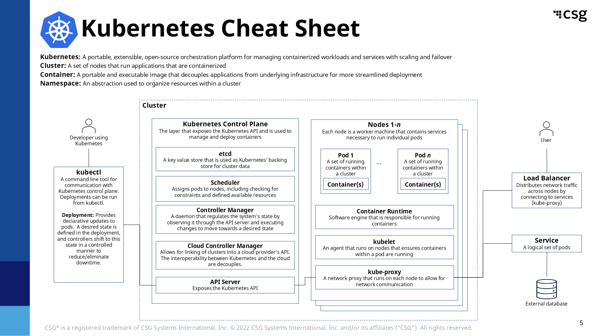

# Kubernetes and Docker

> Concepts, `kubectl` recipes and Minikube workflow, collected while working through a Docker + Kubernetes course.

## Contents
1. [Docker essentials](#1-docker-essentials)
2. [Core concepts](#2-core-concepts)
3. [kubectl daily commands](#3-kubectl-daily-commands)
4. [Manifests](#4-manifests)
5. [Rollouts and rollbacks](#5-rollouts-and-rollbacks)
6. [Services and networking](#6-services-and-networking)
7. [Storage and secrets](#7-storage-and-secrets)
8. [Scaling](#8-scaling)
9. [Minikube](#9-minikube)
10. [Observability tools](#10-observability-tools)

---

## 1. Docker essentials
```bash
docker run -it ubuntu bash                  # -i keep STDIN open, -t allocate a TTY
docker run --rm ubuntu cat /etc/os-release  # --rm cleans up after exit
docker run -d --rm -P nginx                 # -d detached, -P publish all exposed ports
docker run -d --rm -p 12345:80 nginx        # host 12345 -> container 80
docker run -d -p 8083:80 -v "$(pwd)/site:/usr/share/nginx/html" --name web nginx

docker pull docker.io/spurin/funbox:latest  # registry/user/image:tag
docker pull docker.io/spurin/funbox@sha256:<DIGEST>   # pin by content hash

docker images [--digests]
docker history alpine:latest
docker inspect --format='{{index .RepoDigests 0}}' alpine:latest
docker buildx imagetools inspect spurin/funbox --raw
docker save spurin/funbox -o funbox.tar

docker ps -a
docker logs <container>
docker exec -it <container> sh
docker rmi -f <image>
docker system prune -a                      # removes ALL unused images, careful

docker build -t <user>/<image>:v1 .
docker push  <user>/<image>:v1

docker-compose -f docker-compose-dev.yml up [--build]
docker-compose -f docker-compose-dev.yml down
```
Image reference anatomy: `docker.io` (registry) / `spurin` (user) / `funbox` (image) : `latest` (tag, default). A digest is the SHA-256 of the image content, so it never changes.

Use Minikube's Docker daemon so locally built images are visible to the cluster:
```bash
eval $(minikube docker-env)       # or: eval $(minikube -p <profile> docker-env)
```

## 2. Core concepts
| Object | Purpose |
|---|---|
| **Node** | Machine or VM that runs containers. Runs `kubelet` and `kube-proxy` |
| **Control plane** | `kube-apiserver`, `kube-scheduler`, `kube-controller-manager`, etcd |
| **Pod** | Smallest deployable unit: one or more tightly coupled containers |
| **ReplicaSet** | Keeps N identical Pods running. Normally managed by a Deployment |
| **Deployment** | Declarative updates: creates ReplicaSets, does rolling updates and rollbacks |
| **DaemonSet** | Exactly one Pod per node (log shippers, CNI, kube-proxy) |
| **Service** | Stable virtual IP and load balancing in front of Pods |
| **Ingress** | HTTP routing from outside the cluster to Services |
| **Namespace** | Virtual sub-cluster. Names are unique per namespace |
| **Secret / ConfigMap** | Sensitive / non-sensitive configuration |
| **PV / PVC / StorageClass** | Persistent storage, claim for it, and dynamic provisioning |

Principles:
- Kubernetes **does not build images**; it pulls them from a registry.
- You describe the **desired state** (declarative); controllers constantly reconcile the actual state.
- Imperative: "run these steps". Declarative: "the setup should look like this".
- **Labels** are key/value pairs. **Selectors** match them: equality-based (`env=dev`, `env!=dev`) or set-based (`env in (dev,qa)`, `!app`).

Service types:
| Type | Exposure |
|---|---|
| `ClusterIP` | Inside the cluster only (default) |
| `NodePort` | On every node's IP at a high port. Dev use only |
| `LoadBalancer` | Cloud LB (Minikube: `minikube tunnel`) |
| Ingress | Layer-7 routing for many Services |

## 3. kubectl daily commands
```bash
kubectl version; kubectl cluster-info; kubectl get nodes
kubectl config view
kubectl config set-context --current --namespace=<ns>

kubectl get namespaces
kubectl create namespace <ns>
kubectl get pods -A
kubectl get pods -o wide
kubectl get pods --show-labels
kubectl get pods -l app=nginx
kubectl get pods -L k8s-app,label2           # show label values as columns
kubectl get deploy,rs,po -l app=nginx
kubectl get all -l app=<name> -o wide
kubectl get svc,ep -A

kubectl describe pod <pod>
kubectl logs <pod>                            # add -f to follow, --previous for crashed
kubectl exec -it <pod> -- sh
kubectl port-forward svc/<svc> 8080:80
kubectl explain pod.spec.containers           # API schema, not live objects
kubectl api-resources
kubectl options

kubectl delete -f <file>.yaml
kubectl delete deployment <name>
kubectl delete all --all -n <ns>              # destructive
```
`-o wide` adds columns, `-o yaml|json` dumps the object, `--dry-run=client -o yaml` generates a manifest without creating anything.

Proxy to the API server:
```bash
kubectl proxy &
curl http://localhost:8001/
```
Node maintenance: `kubectl cordon <node>` marks it unschedulable. `kubectl taint` repels Pods.

## 4. Manifests
Generate a starting point instead of typing YAML:
```bash
kubectl run nginx-pod --image=nginx:1.22.1 --port=80 --dry-run=client -o yaml > nginx-pod.yaml
kubectl create deployment nginx-deployment --image=nginx:1.20.2 --port=80 --replicas=3 \
  --dry-run=client -o yaml > nginx-deploy.yaml
kubectl apply -f nginx-deploy.yaml            # create or update
kubectl apply -f ./k8s/                       # a whole folder
```
**Deployment**
```yaml
apiVersion: apps/v1
kind: Deployment
metadata:
  name: nginx-deployment
  labels: { app: nginx-deployment }
spec:
  replicas: 3
  selector:
    matchLabels: { app: nginx-deployment }
  template:
    metadata:
      labels: { app: nginx-deployment }
    spec:
      containers:
        - name: nginx
          image: nginx:1.20.2
          ports:
            - containerPort: 80
```
**DaemonSet**
```yaml
apiVersion: apps/v1
kind: DaemonSet
metadata:
  name: fluentd-agent
  labels: { k8s-app: fluentd-agent }
spec:
  selector:
    matchLabels: { k8s-app: fluentd-agent }
  template:
    metadata:
      labels: { k8s-app: fluentd-agent }
    spec:
      containers:
        - name: fluentd
          image: quay.io/fluentd_elasticsearch/fluentd:v4.5.2
```

## 5. Rollouts and rollbacks
A rolling update starts when the **Pod template** changes (image, ports, volumes). Scaling or relabeling the Deployment does not create a new revision.
```bash
kubectl set image deploy/nginx-deployment nginx=nginx:1.21.5
kubectl rollout status  deploy/nginx-deployment     # "successfully rolled out"
kubectl rollout history deploy/nginx-deployment
kubectl rollout history deploy/nginx-deployment --revision=2
kubectl rollout undo    deploy/nginx-deployment --to-revision=1
kubectl scale deploy nginx-deployment --replicas=4
```
`--record` stores the command in the `CHANGE-CAUSE` column. It is deprecated; prefer the annotation `kubernetes.io/change-cause`.

ReplicaSets: `kubectl get rs`, `kubectl scale rs <name> --replicas=4`. Use them directly only for learning; use Deployments in practice.

## 6. Services and networking
```bash
kubectl expose deployment web --port=80 --type=NodePort
kubectl expose deployment web --name=web-lb --type=LoadBalancer --port=8080
kubectl get endpoints <svc>
kubectl port-forward svc/postgres-service 5432:5432
```
```yaml
ports:
  - port: 5432        # port the Service exposes
    targetPort: 5432  # port on the container
```
Flow: `localhost:5432 -> Service -> Endpoints (Pod IP) -> Pod -> container`.
Deployments create Pods with labels; Services select Pods by those labels.

NodePort mapping example from an ingress controller: `80:32522/TCP,443:31196/TCP` (service port : node port).

## 7. Storage and secrets
```bash
kubectl get storageclass
kubectl get pv; kubectl get pvc
```
Access modes: `ReadWriteOnce` (one node), `ReadOnlyMany` (many readers), `ReadWriteMany` (many readers and writers).
Static provisioning needs pre-created volumes; dynamic provisioning creates them from a `StorageClass` when a PVC is applied.

Secrets:
```bash
# Avoid passing real values on the command line: they land in shell history.
kubectl create secret generic db-credentials --from-literal=PGPASSWORD="$PGPASSWORD"
kubectl create secret generic db-credentials --from-env-file=./db.env     # file is git-ignored
kubectl get secrets
kubectl describe secret db-credentials          # values are hidden
```
Secrets are only base64-encoded by default. Enable encryption at rest and restrict RBAC for real workloads.

## 8. Scaling
| Kind | What changes |
|---|---|
| **HPA** (Horizontal Pod Autoscaler) | Number of Pods |
| **VPA** (Vertical Pod Autoscaler) | CPU and memory of each Pod |
| **Cluster Autoscaler** | Number of nodes |

```bash
kubectl autoscale deploy <name> --min=2 --max=5 --cpu-percent=80
kubectl get hpa; kubectl describe hpa
```
HPA does not apply to DaemonSets.

## 9. Minikube
```bash
minikube start [--driver=virtualbox|docker]
minikube status | stop | delete | version
minikube ip
minikube node list
minikube profile list
minikube start -p <profile>; minikube stop -p <profile>; minikube delete -p <profile>
minikube -p <profile> ip -n <profile>-m02

minikube addons list
minikube addons enable ingress
minikube addons enable metrics-server
minikube addons enable dashboard
minikube dashboard --url

minikube service <svc>            # open a Service in the browser
minikube service <svc> --url
minikube service list
minikube tunnel                   # makes LoadBalancer Services reachable
```
Install on Linux:
```bash
curl -LO https://github.com/kubernetes/minikube/releases/latest/download/minikube-linux-amd64
sudo install minikube-linux-amd64 /usr/local/bin/minikube && rm minikube-linux-amd64
source <(minikube completion bash)      # shell completion
```
To reach a Minikube running on a remote VM from your laptop, see [ssh-tunnels-and-windows.md](ssh-tunnels-and-windows.md).

## 10. Observability tools
- **OpenTelemetry**: vendor-neutral APIs and SDKs for traces, metrics and logs. You own your data.
- **Jaeger**: distributed tracing backend.
- **Prometheus**: metrics collection and alerting (not tracing).
- **Flux**: GitOps continuous delivery for Kubernetes.


