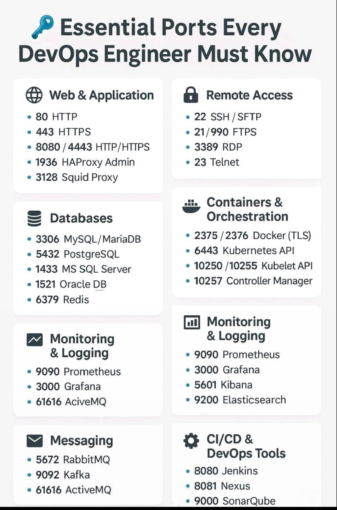
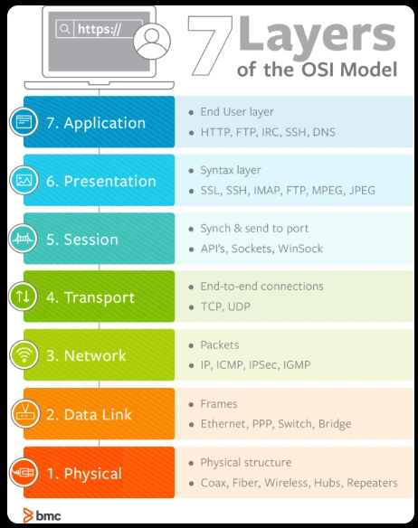

# Networking Reference

## Essential ports


| Area | Ports |
|---|---|
| Web | 80 HTTP, 443 HTTPS, 8080/4443 alt HTTP(S), 1936 HAProxy stats, 3128 Squid |
| Remote access | 22 SSH/SFTP, 21/990 FTP/FTPS, 3389 RDP, 23 Telnet (avoid) |
| Databases | 3306 MySQL/MariaDB, 5432 PostgreSQL, 1433 SQL Server, 1521 Oracle, 6379 Redis |
| Containers | 2375/2376 Docker API (plain/TLS), 6443 Kubernetes API, 10250/10255 Kubelet, 10257 Controller Manager |
| Monitoring | 9090 Prometheus, 3000 Grafana, 5601 Kibana, 9200 Elasticsearch |
| Messaging | 5672 RabbitMQ, 9092 Kafka, 61616 ActiveMQ |
| CI/CD | 8080 Jenkins, 8081 Nexus, 9000 SonarQube |

## OSI model


| Layer | Name | Unit | Examples |
|---|---|---|---|
| 7 | Application | Data | HTTP, FTP, SSH, DNS |
| 6 | Presentation | Data | TLS/SSL, MPEG, JPEG |
| 5 | Session | Data | Sockets, APIs |
| 4 | Transport | Segment | TCP, UDP |
| 3 | Network | Packet | IP, ICMP, IPsec |
| 2 | Data link | Frame | Ethernet, switches, bridges |
| 1 | Physical | Bits | Cable, fiber, wireless, hubs |

## Quick diagnosis
```bash
nslookup <HOST>                      # DNS (L7)
nc -zv <HOST> <PORT>                 # TCP reachability (L4)
curl -vk https://<HOST>:<PORT>/      # TLS + HTTP
traceroute <HOST>                    # path (L3)
ss -ltnp                             # what is listening locally
```
```powershell
Test-NetConnection <HOST> -Port 443
```
